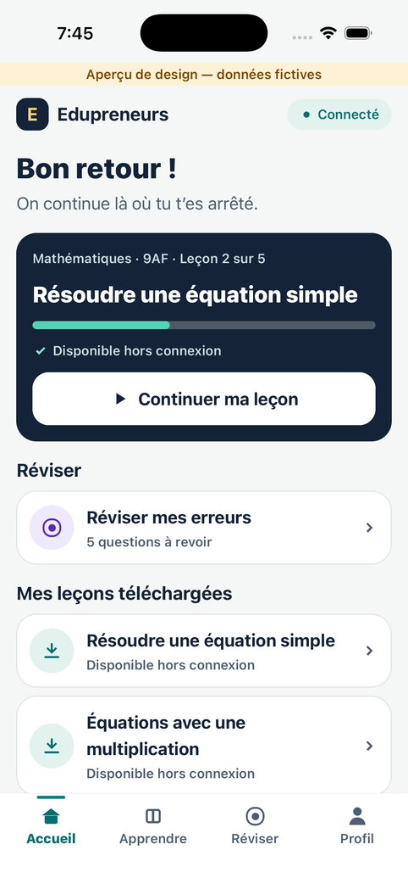
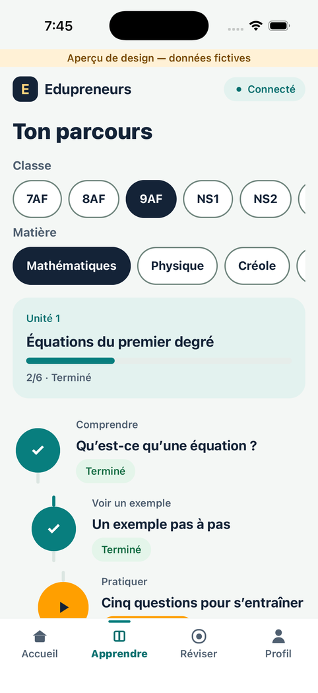
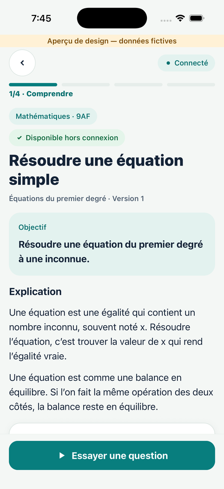
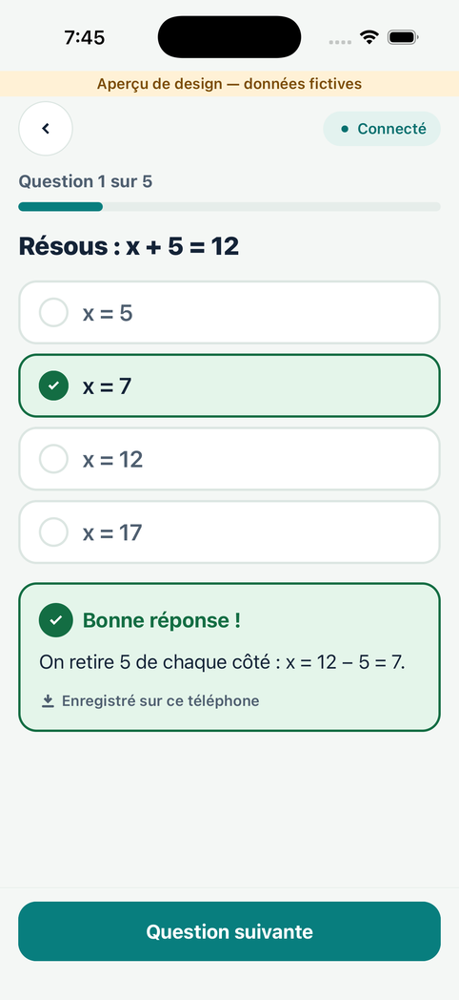
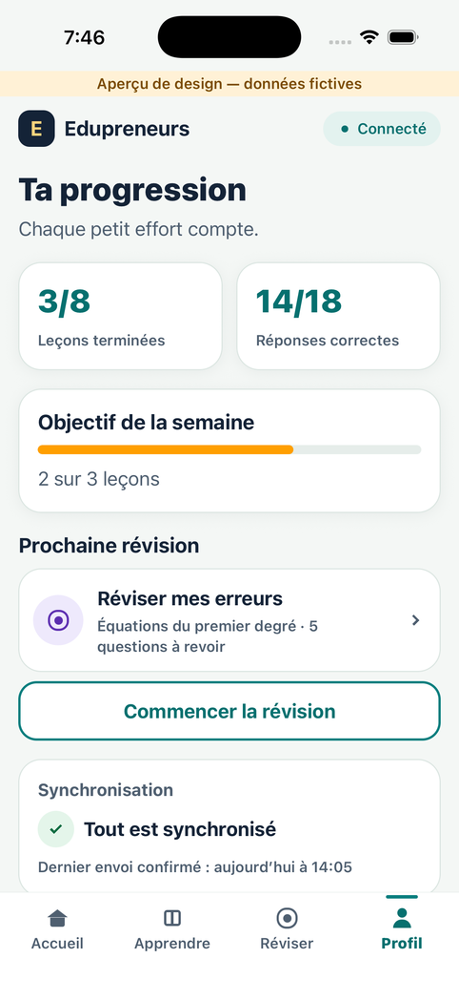
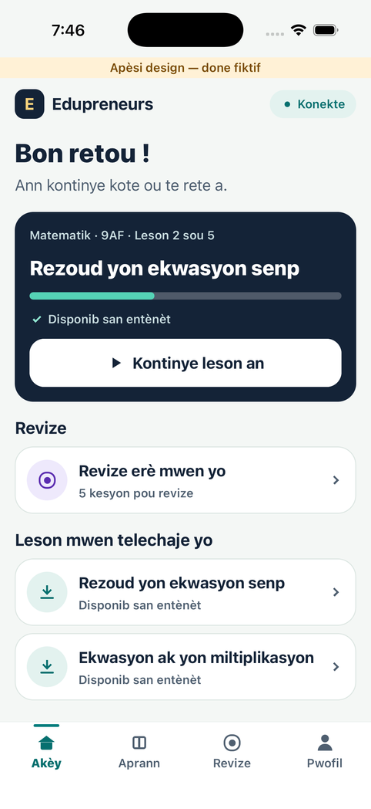
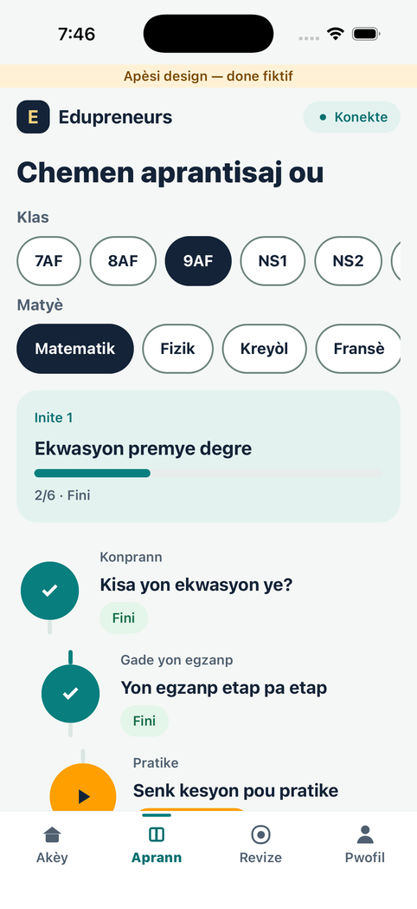
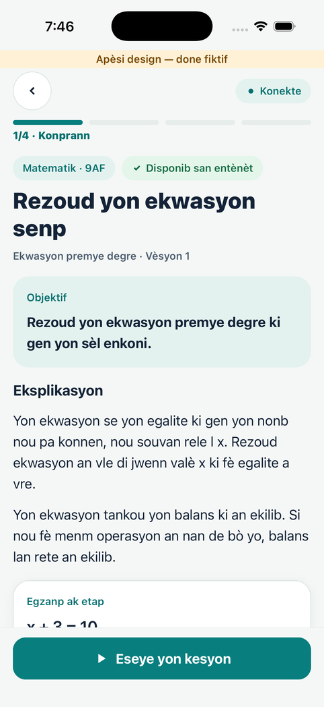
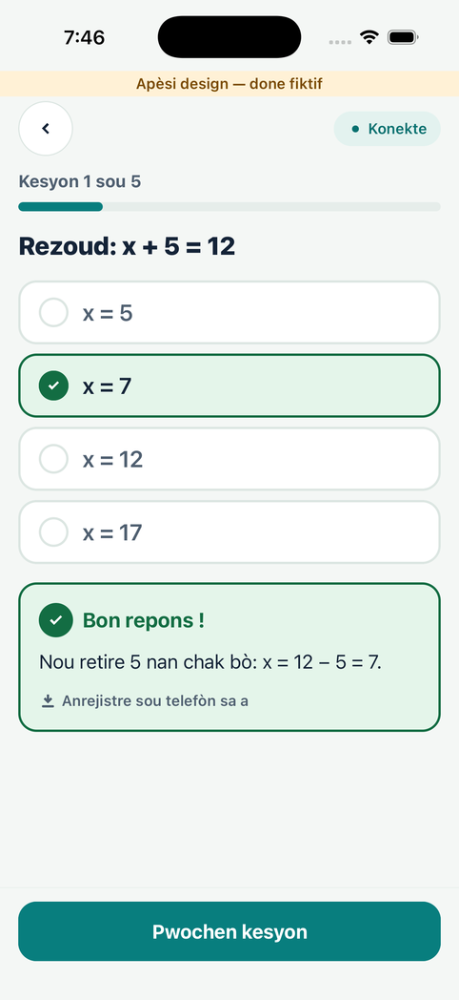
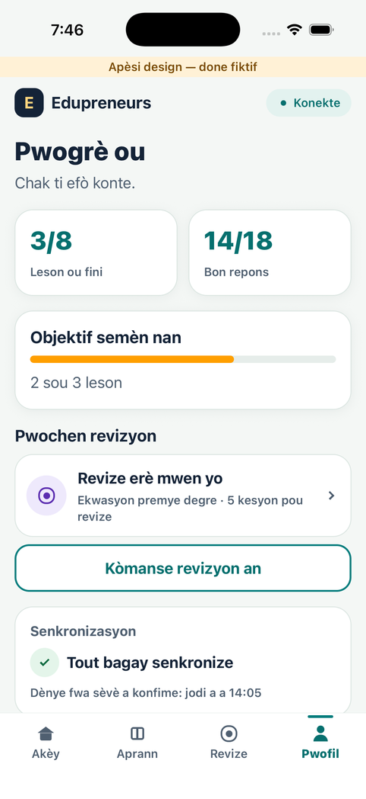

# Edupreneurs

**An offline-first educational platform for Haitian students, built with React Native, FastAPI and PostgreSQL.**

Edupreneurs helps learners in Haiti (grades 7AF to NS4) study on older Android
phones and unreliable networks. A student saves lessons to the phone, reads them
and answers practice questions with no connection, and the work is sent to the
server when the network returns. The interface is in French and Haitian Creole.

> **Status: early development, local only.** Nothing in this repository is
> deployed, and it is **not production-ready**. All data is synthetic. See
> [Current status and limitations](#current-status-and-limitations).

> **Naming.** The product is **Edupreneurs**. Some older documents and
> identifiers use the working title "Mon Edupreneur 2.0" (the domain is
> mon-edupreneur.com).

## Architecture

```
 React Native app (Expo)                FastAPI service               PostgreSQL
 apps/student-native                    services/api                  supabase/migrations
┌──────────────────────────┐   HTTPS   ┌─────────────────────┐  SQL  ┌──────────────────────┐
│ screens (Expo Router)    │──────────▶│ verifies the token  │──────▶│ row-level security   │
│ SQLite: lessons, answers,│  + token  │ catalog, lessons,   │       │ one write function   │
│ outbox of unsent work    │◀──────────│ sync push / pull    │◀──────│ scores and dedupes   │
└──────────────────────────┘           └─────────────────────┘       └──────────────────────┘
            │ sign-in                                                          ▲
            └──────────────────────▶ Supabase Auth (local, Docker) ────────────┘
```

| Layer | Technology | Where |
|---|---|---|
| Student app | React Native 0.88, Expo SDK 58, Expo Router, TypeScript, SQLite on the device | `apps/student-native/` |
| API | Python 3.13, FastAPI, SQLAlchemy (async) with asyncpg | `services/api/` |
| Database | PostgreSQL with row-level security, run locally through the Supabase CLI | `supabase/migrations/` |
| Sign-in | Supabase Auth (asymmetric ES256 tokens; the API holds no signing secret) | `supabase/config.toml` |
| Contract | OpenAPI document and JSON Schemas for lesson content | `packages/contracts/` |

More detail: [`docs/ARCHITECTURE.md`](docs/ARCHITECTURE.md), [`docs/SECURITY.md`](docs/SECURITY.md), [`docs/API_CONTRACT.md`](docs/API_CONTRACT.md).

## What works today

**Backend (Foundation-01)**
- Database schema for curriculum, reviewed lesson revisions in two languages, practice questions, attempts and progress.
- Publication rules: a lesson is visible to students only after a different person has reviewed it.
- API endpoints for the learner profile, the catalog, lesson download, and sync push / pull.
- Exactly-once synchronisation: an answer sent twice, or sent by twenty retries at once, is recorded once. The server scores answers itself.

**Student app (Mobile-01, Release-01)**
- Sign in, browse the catalog, save a lesson to the phone, read it offline.
- Answer practice questions offline; each answer is written to SQLite before the app says it is saved.
- Automatic sync when the network returns, with distinct "saved on this phone", "waiting to sync", "synced" and "failed" states.
- French and Haitian Creole interface.
- Shared-phone safety: one student's saved work is not visible to the next student who signs in.
- Validated as standalone release builds on an Android 7.0 emulator (API 24, 1 GB RAM, 480×800) and an iPhone simulator. Reports: [`docs/RELEASE_01_REPORT.md`](docs/RELEASE_01_REPORT.md), [`apps/student-native/docs/`](apps/student-native/docs/).

**Design-00 (this branch only, not merged into `main`)**
- A design system (colour, type and spacing tokens, about twenty components) and five native screen previews driven by made-up data. See [Design-00 previews](#design-00-previews) below.

## Design-00 previews

This branch adds a proposed visual direction for the student app. The five
screens below are **previews only**: they use invented data, they are reachable
only in development builds (`monedupreneur://design`), and they do not replace
any working screen. They await design approval before being wired into the app.

| Home | Learning path | Lesson | Practice | Progress |
|---|---|---|---|---|
|  |  |  |  |  |
|  |  |  |  |  |

Top row French, bottom row Haitian Creole (draft wording), iPhone simulator.
Bottom tabs: Accueil, Apprendre, Réviser, Profil.

- Specification: [`docs/design/EDUPRENEURS_DESIGN00_SPEC_v0.2.md`](docs/design/EDUPRENEURS_DESIGN00_SPEC_v0.2.md)
- Report (what was built, test results, open decisions): [`docs/design/DESIGN_00_REPORT.md`](docs/design/DESIGN_00_REPORT.md)
- All screenshots, Android 7 and iPhone, including dark mode, large text and offline / error states: [`docs/design/design-00/`](docs/design/design-00/)
- Code: [`apps/student-native/src/design/`](apps/student-native/src/design/) and [`apps/student-native/src/app/design/`](apps/student-native/src/app/design/)

## Offline-first principles

1. **The phone is the first place work is saved.** Lessons and answers live in SQLite on the device; reading and practising never wait for the network.
2. **Never claim more than is true.** "Saved on this phone", "waiting to sync" and "synced" are different states, and the app only says "synced" after the server has acknowledged the work.
3. **Sync is safe to repeat.** Every offline action carries a unique identifier, so retries after a dropped connection cannot create duplicates.
4. **The server decides scores.** The phone shows feedback immediately, but the recorded result is computed by the database.
5. **Built for old phones.** Android 7+ and small screens are test targets, not afterthoughts; there are no heavy animation, 3D or media dependencies on the learning path.
6. **Shared phones are normal.** Each account's data is kept separate on the device, and signing out with unsent work shows a clear warning.

## Repository layout

| Path | What it is |
|---|---|
| `apps/student-native/` | React Native (Expo) student app, its tests, UI test flows and validation reports |
| `services/api/` | The FastAPI service |
| `supabase/migrations/` | The database schema, the single source of truth (ordered SQL files) |
| `supabase/seed.sql` | Synthetic test data: two students, an editor, a reviewer, one grade-9 maths lesson in French and Haitian Creole |
| `supabase/tests/` | Database tests (pgTAP): structure, permissions, publication rules, sync function |
| `tests/` | API tests (pytest): unit, and integration against the real local database and Auth |
| `packages/contracts/` | OpenAPI contract and JSON Schemas |
| `scripts/` | Local-only helpers (setup, test tokens, contract export) |
| `docs/` | Architecture, security, API contract, schema changelog, test and release reports, next steps |
| `docs/design/` | UX direction, the Design-00 specification, report and screenshots |
| `docs/reference/` | The original planning drafts, kept unmodified for comparison |

## Development setup

### Prerequisites (macOS or Linux)

| Tool | Why | Install |
|---|---|---|
| Docker-compatible runtime (Docker Desktop, OrbStack, Colima, or Docker Engine on Linux) | Runs local Postgres + Supabase Auth | docker.com / orbstack.dev |
| Node.js 20+ and npm | Only to install the pinned Supabase CLI | nodejs.org or `nvm` |
| [uv](https://docs.astral.sh/uv/) | Installs Python 3.13 and the Python dependencies from `uv.lock` | `curl -LsSf https://astral.sh/uv/install.sh \| sh` |
| GNU make | Task runner | preinstalled on macOS (Xcode tools) and most Linux |

You do **not** need a Supabase account, a cloud project, or any secret from anyone.

### First-time setup

```bash
make setup
```

This one command: installs the pinned tools, generates a local Auth signing key,
starts the local stack in Docker, rebuilds the database from the migrations and
seed, writes a git-ignored `.env`, and creates the API's least-privilege database login.
The first run downloads about 1.5 GB of Docker images.

### Daily commands and tests

| Command | What it does |
|---|---|
| `make start` / `make stop` | Start / stop the local stack (data is kept between stops) |
| `make db-reset` | **Destroys and rebuilds the local database** from migrations + seed, then re-creates `.env` and the API login |
| `make api` | Run the API at http://127.0.0.1:8000 — interactive docs at http://127.0.0.1:8000/docs |
| `make token ACCOUNT=student_a` | Print a real local access token (`student_a`, `student_b`, `editor`, `reviewer`) |
| `make test-db` | Database tests (pgTAP) |
| `make test-api` | API tests (pytest) |
| `make test` | Both |
| `make lint` / `make typecheck` / `make format` | Ruff and mypy |
| `make check` | Everything CI runs |
| `make openapi` | Regenerate `packages/contracts/openapi.json` after changing the API |
| `make status` | Show local stack URLs |
| `make mobile-install` / `mobile-check` / `mobile-test` | Mobile app: install, static checks, 52 core tests against the local stack |
| `make dev-login ACCOUNT=student_a` | Print an e-mail + password to type into the app |
| `make mobile-env TARGET=ios-sim` then `make mobile-ios` | Configure and run the app on the iOS Simulator (`android-emu` / `mobile-android` for Android) |

### Try it by hand

```bash
make api                                   # terminal 1
TOKEN=$(make -s token ACCOUNT=student_a)   # terminal 2
curl -s -H "Authorization: Bearer $TOKEN" http://127.0.0.1:8000/v1/me
curl -s -H "Authorization: Bearer $TOKEN" "http://127.0.0.1:8000/v1/catalog?locale=ht"
```

More examples, including sync push/pull, are in `docs/API_CONTRACT.md`.

## How a request flows (30 seconds)

1. The phone signs in with **Supabase Auth** and gets a short-lived access token.
2. The phone calls **our FastAPI service** with that token. The API verifies the
   token's signature with Auth's public key — the API itself cannot create tokens.
3. The API talks to **PostgreSQL** as a restricted role. For each request it opens one
   transaction and tells the database "this transaction is for user X". Row-level
   security then only shows that user's rows.
4. Learning data (answers, scores, progress) can only be written by one database
   function, which scores the answer itself and guarantees each offline operation
   is applied exactly once.

Details: `docs/ARCHITECTURE.md` and `docs/SECURITY.md`.

## Safety rules for this repository

- **Local only.** Never run `supabase link`, `supabase db push`, or `supabase db reset --remote` from here.
- `make db-reset` only ever targets the local Docker database.
- Never commit `.env` or `supabase/signing_keys.json` (both are git-ignored).
- All data is synthetic. Do not load real student data into a development database.
- The earlier web proof of concept (built on Lovable) is a separate project: nothing here connects to it.

## Current status and limitations

- **Local development only.** There is no hosted environment, no production database and no app-store release. [`docs/NEXT_STEPS.md`](docs/NEXT_STEPS.md) lists what is missing before any deployment.
- **Synthetic data only.** One sample lesson; no real curriculum content and no real student records.
- **Tested on emulators and simulators, not on physical phones.**
- **Haitian Creole wording is a draft** and still needs review by a Creole-speaking educator.
- **Not built yet:** teacher or parent features, an AI tutor, payments, community, notifications, content-authoring tools.
- **Automated tests:** 209 database tests, 144 API tests and 128 mobile tests (52 from Release-01 plus 76 design-token tests). CI (`.github/workflows/ci.yml`) runs them on a disposable local stack with no cloud project and no repository secrets.
- **Some documents describe one developer's machine** (for example an external development volume in [`docs/DEV_STORAGE.md`](docs/DEV_STORAGE.md)). That set-up is optional; the steps above work from any folder.
- **Licence:** none has been chosen yet. Until one is added, the code is published for reading and review only, with all rights reserved.

## Troubleshooting

| Symptom | Fix |
|---|---|
| `Cannot connect to the Docker daemon` | Start Docker Desktop / OrbStack, then `make start` |
| `port is already allocated` (54321/54322) | Another local Supabase project is running: `npx supabase stop` in that project, or stop the container using the port |
| Tests fail with `.env is missing [...]` | The stack was never set up: `make setup` |
| API returns 503 `dependency_unavailable` | The database is not running (`make start`) or `.env` is stale (`make db-reset`) |
| `password authentication failed for user "edu_api_login"` | The login role is gone after a rebuild: `make db-reset` (re-creates it) |
| Tokens are rejected right after `make db-reset` on a fresh machine | The signing key changed; get a new token with `make token` |
| A database test fails after you edited content by hand | `make db-reset` restores the exact seed state |
| Want the Supabase dashboard | Set `[studio] enabled = true` in `supabase/config.toml`, then `make stop && make start` (http://127.0.0.1:54323) |
