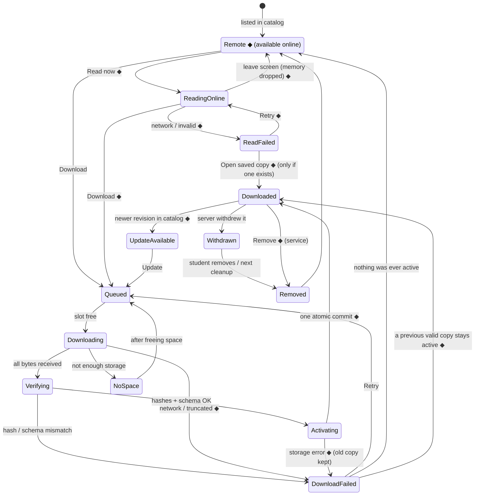

# 3. Unified resource lifecycle

One lifecycle for every resource kind (`lesson`, `pack`, `book`, `exam_practice`, `asset`). The slice implements the
lesson subset (states marked ◆).

Invariants (each is a test or a rule in doc 5):

1. **A resource is `Downloaded` only after the commit.** Before it, the UI says *downloading* or *failed*, never *available offline*.
2. **A failure never removes the last valid copy.** `DownloadFailed` coexists with `Downloaded`.
3. **Removal and withdrawal never delete student records** (progress, attempts, achievements, outbox).
4. **Reading online never creates a row in the downloaded set.**
5. **State is derived from storage, not remembered in the UI**: on app start the state of each resource is recomputed from
   SQLite + files; interrupted `Downloading` rows become `Queued/DownloadFailed`, never `Downloaded`.

## Withdrawn content (policy needed — owner)

There is no takedown route yet (audit L-B2-3). Proposed: the catalog marks a lesson `withdrawn`; the phone keeps the
saved copy readable with a notice *"Cette leçon a été retirée"* until the student removes it **unless** the reason is
legal/safety (`withdrawn_hard`), in which case it is hidden at next catalog refresh. Progress is always kept.

## What the student sees

| State | Catalog row (fr) | Catalog row (ht, *draft*) | Notes |
|---|---|---|---|
| Remote | `Disponible en ligne` · **Lire maintenant** · Télécharger | `Disponib sou entènèt` · **Li kounye a** · Telechaje | Implemented |
| ReadingOnline | pill `En ligne · non téléchargée`; button *Télécharger pour étudier hors ligne* | `Sou entènèt · pa telechaje` | Implemented |
| ReadFailed (offline) | `Impossible de charger la leçon : pas de connexion Internet.` + Réessayer | `Pa ka chaje leson an : pa gen koneksyon entènèt.` | Implemented |
| ReadFailed (not found / session / invalid) | distinct messages | distinct messages | Implemented |
| Downloading | `Téléchargement…` (progress bar for bulk) | `Ap telechaje…` | Implemented (indeterminate for one lesson) |
| Downloaded | pill `Disponible hors connexion` | `Disponib san entènèt` | Implemented |
| UpdateAvailable | `Enregistrée sur ce téléphone · Nouvelle version disponible` · Mettre à jour | existing strings | Existing |
| DownloadFailed | keeps old copy: `Téléchargement impossible. La version déjà enregistrée est conservée.` | existing | Existing |
| NoSpace | `Pas assez d’espace. Libère … Mo.` | to write | Designed |
| "Internet required" | shown when the student presses *Lire maintenant* with no connection (honest, after trying) | | Implemented. We do **not** guess connectivity in advance: the existing app shows a truthful state only (audit item 3-4). |

Haitian Creole strings above are **drafts**; they must be reviewed by an educator before release.
