# 3. Domain-boundary architecture

A proposal for how Edupreneurs 2.0 should be divided as it grows from one
module (offline learning) to the full product. It keeps the choices already
made on `main` — one API service, one PostgreSQL database, the device trusted
for nothing — and extends the pattern Social-00 introduced: **a separate
database schema and role wherever the trust level is different.**

"Schema" = a named folder of tables in the database. "Role" = a database
account with fixed permissions; what a role cannot do, the code using it cannot
do either, even with a bug.

## The picture

```mermaid
flowchart TB
    subgraph clients["Clients (untrusted)"]
        M["Student app<br/>React Native, offline-first"]
        W["Public website<br/>marketing, pay, gift, privacy"]
        S["Staff portal<br/>web, second factor"]
    end

    AUTH["Supabase Auth<br/>sign-in, recovery, tokens"]

    subgraph api["FastAPI service (one deployable)"]
        direction TB
        L["learning<br/>/v1/me /catalog /lessons /sync"]
        B["billing<br/>/v1/entitlements /billing"]
        N["notify<br/>/v1/notifications"]
        T["tutor (Jude)<br/>/v1/jude"]
        SO["social<br/>/v1/social"]
        G["games<br/>later"]
        ST["staff<br/>/v1/staff"]
    end

    subgraph workers["Workers (separate process)"]
        PK["pack builder"]
        RC["payment reconciliation"]
        DL["notification delivery"]
        GEN["AI drafting"]
        RET["retention and erasure"]
    end

    subgraph db["PostgreSQL (one instance, private schemas)"]
        APP[("app<br/>identity, curriculum, publication,<br/>learning, sync, rewards, exams, privacy")]
        BILL[("billing<br/>plans, orders, provider events,<br/>entitlements")]
        NOT[("notify<br/>outbox, push tokens, preferences")]
        TUT[("tutor<br/>usage, budgets, optional threads")]
        SOC[("social<br/>per Social-00")]
    end

    R2[("Object storage<br/>packs, images, audio, PDFs")]
    EXT["External services<br/>mobile money, cards, push, e-mail, AI"]

    M --> AUTH
    W --> AUTH
    S --> AUTH
    M --> L
    M --> B
    M --> N
    M --> T
    M --> SO
    W --> B
    S --> ST

    L --> APP
    B --> BILL
    N --> NOT
    T --> TUT
    SO --> SOC
    ST --> APP

    PK --> APP
    PK --> R2
    RC --> BILL
    DL --> NOT
    GEN --> APP
    RET --> APP

    M -.downloads.-> R2
    RC --> EXT
    DL --> EXT
    T --> EXT
    GEN --> EXT
    B --> EXT
```



The same thing as text, for places that do not render diagrams:

```
 Student app ─┐                      ┌─ learning ──► schema app      (role edu_api)
 Website ─────┼─► FastAPI service ───┼─ billing ───► schema billing  (role edu_billing)
 Staff portal ┘   (one deployable)   ├─ notify ────► schema notify   (role edu_notify)
      │                              ├─ tutor ─────► schema tutor    (role edu_tutor)
      ▼                              ├─ social ────► schema social   (roles per Social-00)
 Supabase Auth                       └─ staff ─────► schema app      (role edu_staff)
 (sign-in only)
                   Workers ─► pack builder · reconciliation · delivery · AI drafting · retention
                              each with its own narrow role
                   Object storage ◄─ packs, images, audio, PDFs ─► downloaded by the app
```

## Modules

| Module | Owns | Schema | Why its own boundary (or not) | Status |
|---|---|---|---|---|
| **learning** | Profile, curriculum, publication, progress, attempts, sync; later rewards, exams, notes | `app` | The core. Rewards and exams stay here because they are computed **from learning events in the same transaction** — splitting them would reintroduce "trust a number from somewhere else" | Existing and tested (core); rest missing |
| **staff** | Authoring, review, release, support actions, audit | `app` (different role) | Same data, far more power: needs a different role, a second factor and an audit row for every action | Tables partly exist; API missing |
| **billing** | Plans, orders, provider events, entitlements, refunds | `billing` | Money. Must be changeable only by verified provider events or audited staff actions. Other modules may only *ask* "is this learner entitled to X?" | Missing |
| **notify** | Outbox, push tokens, preferences, delivery log | `notify` | A shared service: many modules produce, one delivers. Kept separate so no module needs e-mail or push credentials | Missing |
| **tutor** | Jude requests, budgets, usage, optional threads | `tutor` | Children's free text and a third-party AI cost. Different retention, different consent, and a kill switch | Deliberately deferred |
| **social** | Communities, posts, moderation | `social` | Children's user-generated content; see Social-00 | Designed |
| **games** | Matches, results | later | Only if real-time play is ever built; solo and asynchronous modes live in learning | Not planned |
| **privacy** | Consent, deletion and export requests, retention settings | `app` | Small, and must reach every module — implemented as an orchestrator that calls each module's own erase function | Missing |

## Rules between modules

These are the rules that keep the offline-first foundation intact as modules
are added. Each is testable.

1. **The device is never the authority.** No module accepts a score, a
   balance, a paid flag, a role, a result or another user's id from a client.
   (Already true and tested in `learning`; becomes the entry rule for every new module.)

2. **One writer per fact.**

   | Fact | Only writer |
   |---|---|
   | A learner answered / completed something | `app.sync_apply_operation()` |
   | Points, streak | The same function (or one it calls) — never an endpoint of its own |
   | A learner is entitled to something | `billing`, from a verified provider event or an audited staff grant |
   | A lesson is visible to students | The staff release step, guarded by triggers |
   | A notification exists | The producing module's server code, into the outbox |
   | A post is visible | A moderator's approval (Social-00) |

3. **Modules talk through the API layer or narrow database functions — never
   by reading each other's tables.** Allowed crossings, all read-only:

   | From | To | What | How |
   |---|---|---|---|
   | learning | billing | "may this learner open this course?" | one function, returns yes/no and an expiry |
   | tutor | learning | approved lesson text; the caller's own progress | the same service functions the app uses, under the learner's identity |
   | tutor | billing | "how much may this learner use today?" | the entitlement function |
   | any module | notify | "tell this learner X" | insert into the outbox through one function |
   | privacy | every module | "erase this person" | each module's `erase_user` function |
   | social | anything | **nothing** | by design (Social-00) |

4. **Lessons never wait for anything else.** Catalogue, lesson download,
   practice and sync must work when billing, notify, tutor, social and every
   external service are down. Concretely: separate connection pools; no
   synchronous call from a learning endpoint to an external service; the
   entitlement check reads a local table.

5. **Everything a learner needs offline travels in a pack or in the sync
   feed.** A new feature that needs data on the phone gets it one of those two
   ways — not through a third mechanism. (Social-00's separate cache is the one
   deliberate exception, because its data is optional and short-lived.)

6. **Long or external work happens in workers.** An API request never calls an
   AI model to build content, never builds a pack, never waits on a payment
   provider beyond starting a checkout.

7. **Every module that stores personal data ships with three things:** an
   erase function, a retention rule, and tests that another learner cannot
   read it.

## Where each surface fits

| Surface | For | Talks to | Offline |
|---|---|---|---|
| **Student app** (existing) | Learning, practice, exams, progress, rewards, later Jude and community | learning, billing (status), notify, tutor, social | Yes — the reason it exists |
| **Public website** (not built) | Explaining the product, account recovery landing, paying and gifting, privacy notice, deletion request, later a "lite" lesson view for old browsers | billing, static content | No |
| **Staff portal** (not built) | Content authoring and review, releases, learner support, payments, announcements; moderation console (Social-00) | staff, billing (staff role), social moderation | No |

Admin features are **not** part of the student app, unlike the prototype,
where the same web app and the same accounts served learners and founders.

## What changes in the existing code

Nothing in this audit. For orientation only, the proposed package layout
extends what Social-00 suggested:

```
services/api/src/edu_api/
  auth/ db/ errors.py middleware.py      shared, existing
  routers/ sync/ identity.py             learning, existing
  staff/                                 new: authoring, review, release, support
  billing/                               new
  notify/                                new
  tutor/                                 new, later
  social/                                per Social-00
services/worker/                         new: job runner + pipelines
apps/student-native/                     existing
apps/staff-web/                          new
apps/site/                               new, later
```

An import rule (already proposed by Social-00 for its own package) generalises:
a module may import the shared pieces and its own package, never another
module's internals.
