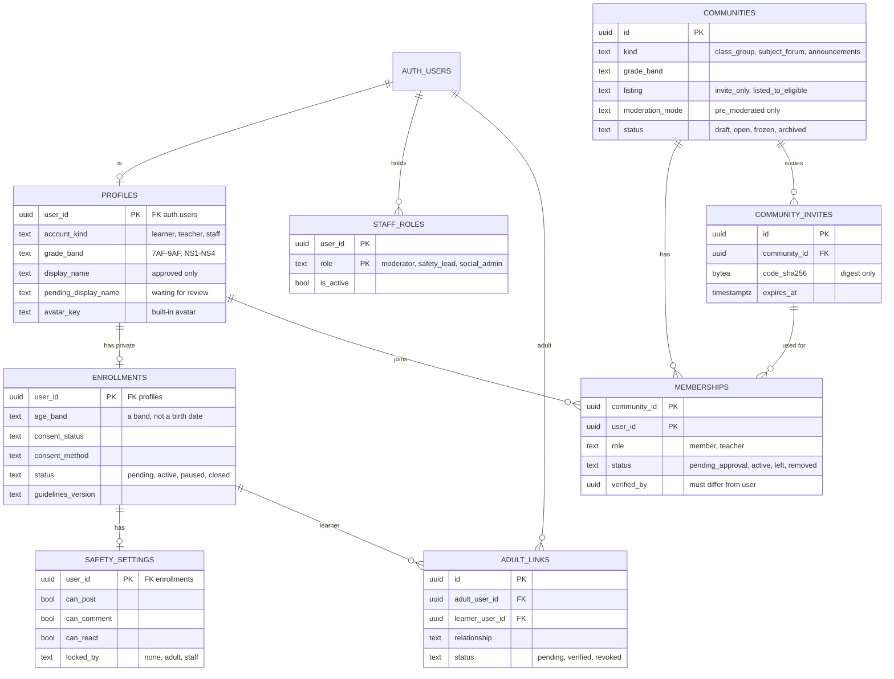
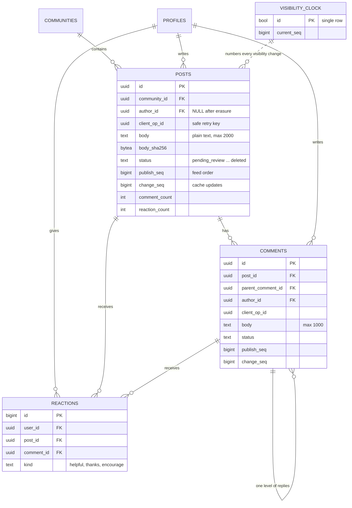
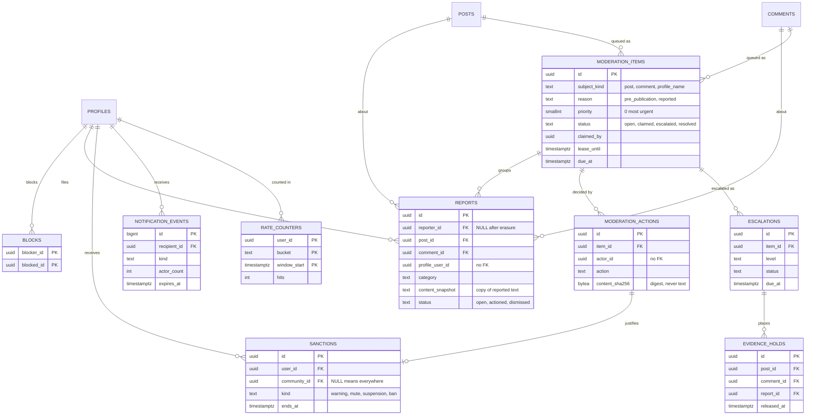

# 2. Database ERD and table dictionary

Source of truth: [migrations/proposed/0002_social_tables.sql](migrations/proposed/0002_social_tables.sql).
If this page and the SQL disagree, the SQL wins and this page has a bug.

**Initial scope: 23 tables, 46 foreign keys, 54 extra indexes, 8 triggers, 31
row-level-security policies, 44 functions.** Direct messaging and media are *not*
in these numbers; see [Future tables](#future-tables-not-in-the-initial-schema).

All tables are in the private schema `social`. Every table has a primary key
and row-level security. `auth.users` is Supabase Auth's user table — the only
object outside `social` that these tables reference.

## Diagrams

GitHub renders these Mermaid diagrams. "PK" = primary key, "FK" = foreign key.
Columns shown are the important ones, not all of them.

### A. People, eligibility and communities



### B. Content



### C. Safety, moderation and operations



Not drawn: `config` (one row of limits and switches) and `audit_events`
(append-only log; no foreign keys on purpose).

## Table dictionary

"Member role sees" = what the student-facing role `edu_social` can read, after
column grants *and* row-level security. "—" means no access at all.

### People and eligibility

| Table | Purpose | Primary key | Foreign keys | Member role sees | When the account is erased |
|---|---|---|---|---|---|
| `staff_roles` | Who may moderate (`moderator`), lead safety (`safety_lead`) or administer (`social_admin`). Separate from `app.staff_roles` | `(user_id, role)` | `user_id`, `granted_by` → `auth.users` (RESTRICT) | — | Staff accounts are not erased by this procedure |
| `profiles` | The **limited public profile**: account kind, approved display name, built-in avatar. No photo, bio, school or contact data | `user_id` | → `auth.users` (RESTRICT) | Own row; rows of people sharing an active community, unless blocked. Columns: `user_id, account_kind, display_name, avatar_key` only | Row deleted |
| `enrollments` | **Private** eligibility: age band, consent, status, accepted rules version | `user_id` | → `profiles` (CASCADE); `enrolled_by`, `consent_recorded_by` → `auth.users` | Own row, 6 columns | Deleted with profile |
| `adult_links` | Which adult account may manage which learner's settings | `id`; unique `(adult, learner)` | adult → `auth.users`; learner → `enrollments` (CASCADE) | — (through functions later) | Deleted |
| `safety_settings` | Per-learner capability switches; can be locked by an adult or staff | `user_id` | → `enrollments` (CASCADE) | Own row | Deleted |

### Communities

| Table | Purpose | Primary key | Foreign keys | Member role sees | Deletion |
|---|---|---|---|---|---|
| `communities` | A closed group. `kind`, grade band, listing, posting rule, `status` | `id`; unique `slug` | `created_by` → `auth.users` | Open/frozen ones where: active member, **or** own pending request, **or** listed and same grade band | Never deleted; `archived` hides it |
| `community_invites` | Join codes, stored as SHA-256 digest; always expire; use counter | `id`; unique `code_sha256` | → `communities` | — | Kept (no secret inside) |
| `memberships` | Verified membership. `active` needs `verified_by` ≠ the member | `(community_id, user_id)` | → `communities`; → `profiles` (CASCADE); `invite_id` → invites (SET NULL); `verified_by` → `auth.users` | Own rows only. **No member directory for learners** | Deleted with profile |

### Content

| Table | Purpose | Primary key | Foreign keys | Member role sees | Deletion / retention |
|---|---|---|---|---|---|
| `posts` | A text post in one community | `id`; unique `(author_id, client_op_id)`, `publish_seq`, `(id, community_id)` | → `communities`; `author_id` → `profiles` (SET NULL) | Own posts in any state; others' only `published`, in a readable community, with no block either way. Not readable: digests and screening columns | See [Deletion semantics](#deletion-semantics) |
| `comments` | A comment, or a reply to a top-level comment | `id`; unique `(author_id, client_op_id)`, `publish_seq`, `(id, post_id)` | `(post_id, community_id)` → `posts`; `(parent_comment_id, post_id)` → `comments`; `author_id` → `profiles` (SET NULL) | As posts, **and** the parent post must be published and visible | Same as posts |
| `reactions` | One positive reaction per person per item | `id`; unique `(user_id, post_id)`, `(user_id, comment_id)` | → `profiles`, `posts`, `comments` (CASCADE) | **Own rows only** — nobody can list who reacted | Deleted with profile; totals adjusted |

### Safety and moderation

| Table | Purpose | Primary key | Foreign keys | Member role sees | Retention |
|---|---|---|---|---|---|
| `blocks` | A blocks B | `(blocker_id, blocked_id)` | both → `profiles` (CASCADE) | Own blocks (as blocker). Nobody can see who blocked them | Deleted with either profile |
| `reports` | A report with category, optional note, and a **copy of the reported text** | `id`; unique per reporter and subject | `reporter_id` → `profiles` (SET NULL); `post_id`, `comment_id`; `moderation_item_id` | Own reports: id, subject, category, status, date. Not the snapshot, not the outcome details | Note and snapshot erased 365 days after resolution |
| `moderation_items` | The queue: one row per thing a human must look at | `id`; at most one unresolved item per subject and reason | → `posts`, `comments`, `communities` | — | Kept (no text) |
| `moderation_actions` | **Append-only** record of every decision, with a digest of the content | `id` | `item_id` → items; other ids are plain uuids on purpose | — | 730 days, then deleted by the retention job |
| `sanctions` | Warning, mute, suspension, ban; optionally limited to one community | `id` | `user_id` → `profiles` (CASCADE); `community_id`; `action_id` → actions | Own rows, 8 columns | Deleted with profile; the action row remains |
| `escalations` | A serious case handed to the safety lead or beyond, with a deadline | `id` | `item_id` → items | — | Kept until legal advice says otherwise (D-12) |
| `evidence_holds` | Stops erasure of one post, comment or report while a case is open | `id` | → `posts`, `comments`, `reports`, `escalations` | — | Kept |

### Operations

| Table | Purpose | Primary key | Member role sees | Retention |
|---|---|---|---|---|
| `config` | One row: kill switch, rules version, all limits and retention periods | `id` (always true) | `submissions_open`, `guidelines_version` | — |
| `visibility_clock` | One row: the counter that orders every visibility change | `id` (always true) | — | — |
| `notification_events` | Pull-based events for a person. **Ids only, never text** | `id` | Own rows | 30 days |
| `audit_events` | **Append-only** log of sensitive actions and refusals | `id` | — | 730 days |
| `rate_counters` | Fixed-window counters per person and action | `(user_id, bucket, window_start)` | — | 2 days |

## Lifecycle states

### Posts and comments (enforced by trigger `content_update_guard`)

```
                 approve (by someone else, same text digest)
 pending_review ───────────────────────────────────────────► published ◄─── restore ───┐
      │                                                        │    │                   │
      │ reject                                         remove  │    │ auto-hide         │
      ▼                                                        │    ▼                   │
   rejected                                                    │  hidden ───────────────┘
                                                               │    │ remove
                                                               ▼    ▼
                                                              removed

 pending_review | published | hidden ── author deletes / account erased ──► deleted
```

- A row can only be **inserted** as `pending_review` (trigger `content_insert_guard`).
- `rejected`, `removed`, `deleted` are final. There is no path back to `published`.
- The text can never change. It can only be erased (`body = NULL`), and only in a final state.
- `publish_seq` is assigned once, at first publication, and never changes; a
  restored post returns to its original place in the feed.
- `change_seq` gets a new value at every visibility change. Phones use it to learn that something disappeared.

### Other lifecycles

| Thing | States |
|---|---|
| Enrolment | `pending` → `active` ⇄ `paused` (consent withdrawn, or staff) → `closed` |
| Membership | `pending_approval` → `active` → `left` \| `removed`; `pending_approval` → `removed` (declined). `left` may request again; `removed` cannot re-join by itself |
| Community | `draft` → `open` ⇄ `frozen` (read-only) → `archived` |
| Moderation item | `open` → `claimed` (15-min lease) → `resolved`; `claimed` → `open` when the lease expires; `claimed` → `escalated` → `resolved` |
| Report | `open` → `actioned` \| `dismissed` |
| Sanction | active while `lifted_at IS NULL` and now is between `starts_at` and `ends_at`; a ban has no `ends_at` |
| Display name | `pending_display_name` set → approved (copied to `display_name`) or rejected (cleared) |

## Visibility rules (who can see what)

| Data | Author / owner | Members of the same community | Other enrolled learners | Teacher of the group | Moderator | Anyone else |
|---|---|---|---|---|---|---|
| Published post or comment | yes | yes, unless a block exists either way | no | yes | yes | no |
| Pending / rejected / removed / hidden content | yes (own) | no | no | no¹ | yes | no |
| Display name and avatar | yes | yes, unless blocked | no | yes | yes | no |
| Pending display name, grade band | yes (own, via function) | no | no | no | yes | no |
| Age band, consent | own status only | no | no | no | age band only | no |
| Who reacted | own reaction only | no (total only) | no | no | no | no |
| Who is a member | own membership only | no | no | yes (their group) | yes | no |
| Who reported / who blocked | own reports / own blocks | no | no | no | reports: pseudonym; identity only for the safety lead | no |
| Community name | yes | yes | only if listed **and** same grade band | yes | yes | no |
| Sanctions | own | no | no | no | yes | no |

¹ Teacher approval of their own class's posts is a later, separately gated step (roadmap, Social-04).

"No" for other learners is returned as the same `404` as "does not exist", so
ids cannot be probed.

## Deletion semantics

| Event | Row | Text | Others see | Counters |
|---|---|---|---|---|
| Author deletes own content | stays, `status = 'deleted'` | erased at once — **unless** a report or evidence hold is open (then kept until resolved) | gone immediately; phones drop it at the next `updates` call | `comment_count` reduced |
| Moderator rejects | stays, `rejected` | kept 30 days (so the author can read it and resubmit), then erased | never saw it | — |
| Moderator removes | stays, `removed` | kept 90 days (appeals, repeat-offence review), then erased | gone immediately | reduced |
| Post goes away with comments under it | comment rows untouched | untouched | comments become unreachable (their policy requires a published parent) | — |
| Reporter's or author's **account is erased** | content rows stay with `author_id = NULL`; reports stay with `reporter_id = NULL` | all their text erased at once | their content disappears | adjusted |
| Community archived | everything stays | untouched | invisible to members | — |

Erasure is refused while an evidence hold is active on that person's content
(`blocked_by_evidence_hold`); releasing a hold is a safety-lead decision that
needs legal guidance (D-12).

Known limit: an erased **teacher or staff** account still appears in
`verified_by` / `created_by` columns that reference `auth.users`, so the Auth
user row cannot be deleted until those are reassigned. The same limitation
exists in `app` today.

## Retention decisions (proposed defaults — need legal confirmation, D-12)

| Data | Kept for | Then | Setting in `social.config` |
|---|---|---|---|
| Text of rejected content | 30 days | text erased | `retain_rejected_days` |
| Text of removed content | 90 days | text erased | `retain_removed_days` |
| Text of author-deleted content | 0 (or until its report/hold closes) | text erased | — |
| Report note and text snapshot | 365 days after resolution | erased | `retain_reports_days` |
| Moderation actions, audit events (no text) | 730 days | rows deleted | `retain_actions_days` |
| Notification events | 30 days | rows deleted | `retain_notifications_days` |
| Rate counters | 2 days | rows deleted | fixed |
| Anything under an evidence hold | until released | normal rule resumes | — |
| Published content | while the community is open | decision D-13 (end-of-school-year archive) | — |

## Indexes worth knowing

| Index | Serves |
|---|---|
| `idx_posts_feed (community_id, publish_seq DESC) WHERE status = 'published'` | Every feed page: one index range scan, no sort |
| `idx_posts_changes (community_id, change_seq)` / `idx_comments_changes` | `GET /updates` |
| `idx_comments_thread (post_id, publish_seq) WHERE status = 'published'` | Comment pages |
| `idx_posts_author`, `idx_comments_author` | "My submissions", pending and daily caps |
| `idx_mod_items_queue (priority, opened_at) WHERE status IN ('open','claimed')` | "Next item" for moderators |
| `uq_mod_items_open_*` | At most one unresolved queue item per subject and reason |
| `idx_memberships_user WHERE status = 'active'` | Membership checks inside policies (run on every read) |
| `idx_blocks_blocked` | "Did this person block me?" inside policies |
| `idx_*_scrub`, `idx_notifications_expiry` | The retention job |

## Future tables (not in the initial schema)

| File | Tables | Why separate |
|---|---|---|
| [`future/F001_direct_messaging.sql`](migrations/future/F001_direct_messaging.sql) | `conversations`, `conversation_participants`, `messages` | Private messages cannot be human-approved one by one; the pre-moderation guarantee does not carry over. Needs its own approval (D-07, D-08) |
| [`future/F002_media.sql`](migrations/future/F002_media.sql) | `media_assets`, `post_media` | Images of minors, illegal imagery, storage and data cost. Needs D-09, D-10 and a store/legal review |

Neither file is part of the Social-01 migration set.
