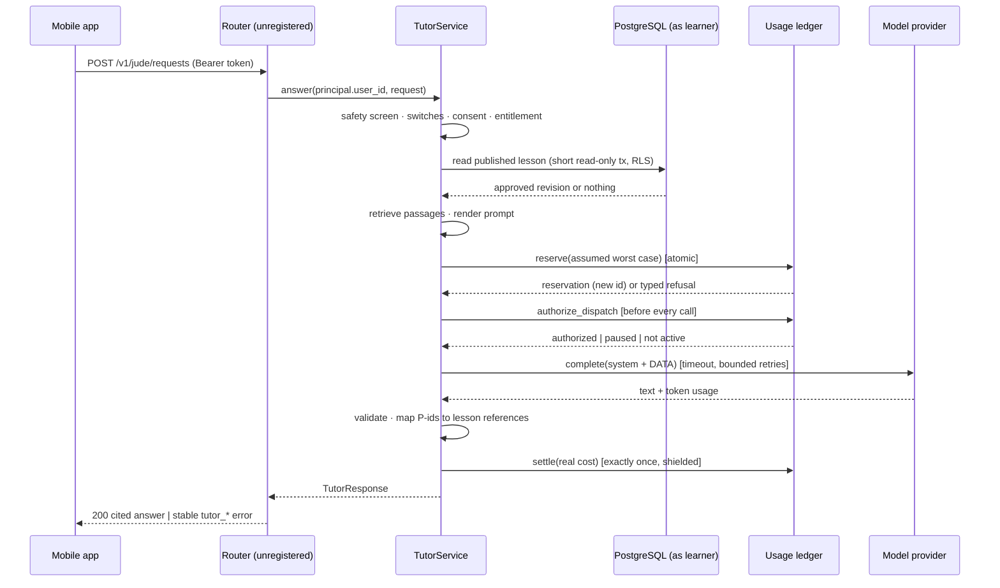

# 2. Request flow

One request, in order. Every step that refuses does so **before** the next one
runs; the right-hand column says whether a provider was called and whether
anything was charged.

| # | Step | Refuses with | Provider called? | Charged? |
|---|---|---|---|---|
| 1 | Verify access token (existing `get_principal`) | `unauthenticated` 401 | no | no |
| 2 | Validate body against `TutorRequest` (no unknown fields, no learner field) | `validation_error` 422 | no | no |
| 3 | Master switch `enabled` | `tutor_disabled` | no | no |
| 4 | **Safety screen** of the message | — returns the fixed support message (not professionally reviewed) | no | no |
| 5 | Kill switch (settings + ledger) | `tutor_paused` | no | no |
| 6 | Consent must be `granted` | `tutor_consent_required` | no | no |
| 7 | Entitlement | `tutor_not_entitled` | no | no |
| 8 | Manipulation / unsuitable request | — returns a fixed reply | no | no |
| 9 | Load the approved lesson **as the learner** | `tutor_lesson_unavailable`, `tutor_lesson_revision_not_current` | no | no |
| 10 | Check the request against the lesson (block, question, choice); decide answer correctness from the reviewed key | `tutor_invalid_request` | no | no |
| 11 | Controlled assessment? | — returns a fixed reply | no | no |
| 12 | Retrieve relevant passages | — nothing relevant: fixed "not in this lesson" reply | no | no |
| 13 | Render the prompt (trusted system message + untrusted DATA) | — | no | no |
| 14 | **Reserve** the assumed worst case atomically ([06](06-cost-and-budget.md)); a new reservation id per admission | `tutor_paused`, `tutor_duplicate_request`, `tutor_request_in_progress`, `tutor_too_many_requests`, `tutor_busy`, limit errors | no | no |
| 15a | **Authorise** each provider call (kill switch and hold re-checked before the first call, every retry and the fallback) | `tutor_paused`, `tutor_unavailable` | no | see 17 |
| 15b | Call the provider through the gateway | `tutor_provider_timeout`, `tutor_provider_unavailable` | **yes** | see 17 |
| 16 | Validate the output (the call's usage is already on record) | `tutor_invalid_model_output`; `tutor_unavailable` if the check itself fails | — | see 17 |
| 17 | **Settle** the real cost, exactly once — also on failure and on cancellation | — | — | real cost |
| 18 | Return the cited answer | — | — | — |

## Why the safety screen is step 4

A message the phrase list recognises as a child in danger gets the fixed
supportive message even if they have no consent record, no entitlement and no budget, and
even when the kill switch is on. That reply is fixed text chosen on the server:
nothing leaves the server, so none of the gates that protect third-party
processing or spending apply. Only the master switch comes first: when Jude is
off, the route does not answer at all.

## What happens on each kind of failure in steps 15–17

| What happened | Recorded cost | Counts as one of the learner's daily questions? | Same key retryable? |
|---|---|---|---|
| Answer validated | Provider-reported tokens × price | yes | no — `tutor_duplicate_request` |
| Output rejected (all attempts) | Provider-reported tokens for every attempt | no | no |
| Timeout / connection lost mid-call / unreadable metering | **The bound** for that attempt (usage unknown) | no | no |
| The server's own validation failed after a metered call | Provider-reported tokens; no further call | no | no |
| Provider reported more than the bound | **What it reported**, uncapped; `overage_micro` kept; tutor paused | as the outcome says | no |
| Paused during retry backoff | Calls already dispatched are settled; no new call | no | no |
| Every dispatched call refused before any work (rate limit, auth, redirect) | 0 — the hold is released | no | **yes**, as a new reservation |
| Client disconnected (task cancelled) | The bound for the in-flight attempt | no | no |
| Worker died before settling | The reservation expires and is charged in full | yes | no |

The rule: a hold is given back only when no call that could be billed was
made. When the truth is unknown the ledger assumes the provider billed the
bound; when the provider reports more than the bound, the ledger records what
it reported and stops ([12](12-security-corrections.md)).

## Sequence

