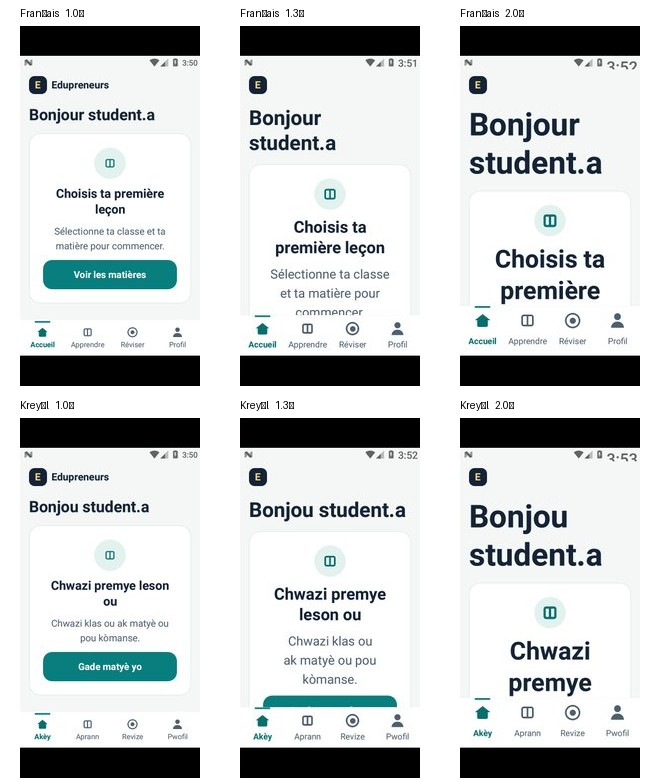

# Independent Mobile-02 and Content-Delivery-00 QA

**Hold the consolidated merge.** Independent verification targets [PR #25 at 3ed9a197164fa177d8a353aa71e0b52c69eddd1e](https://github.com/steevy-cpu/edupreneurs-platform/commit/3ed9a197164fa177d8a353aa71e0b52c69eddd1e). The existing live suites passed. Five additional probes failed, including two ways a replacement download can leave a learner with the wrong or unreadable offline revision.

## Published candidate results

| Gate | Independent evidence on the pinned SHA |
| --- | --- |
| Database and isolation | New GitHub-hosted VM with project `edu-qa-45840800322-1`. The QA wrapper verified the database and gateway container bindings and effective service/Auth URLs before the suites. The #20 harness reported DB port 41002, gateway 41001 and API 41000. The shared override was unset. The network-free mixed-endpoint probe still reproduced QA-7. |
| PostgreSQL and backend | 215 pgTAP assertions passed, 148 pytest cases passed, and all 215 pgTAP assertions passed again after pytest. |
| Mobile static checks and real stack | Generated API types fresh, app and test TypeScript passed, all 441 cases in 30 mobile Jest suites passed. These include real Auth, SQLite, restart/reconnect, server scoring, lost-response recovery, account isolation, download removal and real withdrawal. |
| Independent negative and privacy cases | 6 passed, 5 failed. Home and Réviser displayed the online lesson title, omitted catalog entries were identified as unlisted, late response bodies were discarded, queued work stayed account-specific, and a late Auth refresh could not restore learner A after learner B signed in. QA-2, QA-3, QA-5, QA-6 and QA-7 reproduced. |
| Local cross-check | Across component, unit, experience, delivery and independent probes, 399 passed and 8 failed. Five were the same product/harness findings. The other three were local socket-bind denials; those three passed on GitHub. |
| Android device acceptance | Four of six flows reached the post-restart review. Both 2.0 cells reached the reader. A longer scroll follow-up is running on the same SHA. |

[Independent run and jobs](https://github.com/steevy-cpu/edupreneurs-platform/actions/runs/45840800322) · [Stack log](https://github.com/steevy-cpu/edupreneurs-platform/actions/runs/45840800322/job/139981680977) · [Stack results artifact](https://github.com/steevy-cpu/edupreneurs-platform/actions/runs/45840800322/artifacts/15128201631) · [Review on #25](https://github.com/steevy-cpu/edupreneurs-platform/pull/25#pullrequestreview-6076012498).

### Learner scenarios on the published candidate

| Scenario | Observed behavior |
| --- | --- |
| 1. Read online without a download | The live online-reading suite found zero permanent copies after reading and answering. |
| 2. Reopen a download offline | The real-stack test reopened the saved lesson after recreating the client and SQLite handles offline. |
| 3. Persist and sync online-only answers | Pending answers survived restart. After reconnecting, the API scored them. Retrying a lost response preserved a single operation. |
| 4. Show online-only progress | Independent Home and Réviser assertions both found the lesson title with no saved copy. This closes QA-1. |
| 5. Delete a download | Removing the public copy preserved the learner's attempts, completion and pending work in the real-stack test. |
| 6. Replace interrupted or corrupted content | Ordinary interruptions and storage failures rolled back. A delayed earlier download and an incomplete paragraph both displaced good content (QA-2, QA-3). |
| 7. Switch accounts | Live A/B sessions isolated attempts, lesson references and pending uploads. Late HTTP and Auth results in the independent probes could not replace the new account's state. |
| 8. Withdraw or republish a lesson | The live withdrawal/republication and stale-catalog tests passed. A fresh catalog omission now returns unlisted (QA-4 closed). Service outage and recovery messaging still fail in QA-5 and QA-9. |
| 9. Keep practice separate from controlled exams | The server serves practice only. The independent runtime test saved a response tagged with an unsupported assessment mode (QA-6). |
| 10. Reach controls at large text | See the Android matrix for independent device coverage and the separately attributed candidate screenshots. |

[Candidate integration tests](https://github.com/steevy-cpu/edupreneurs-platform/tree/3ed9a197164fa177d8a353aa71e0b52c69eddd1e/apps/student-native/tests/integration) · [Independent regression cases](acceptance.test.tsx).

### Independent Android evidence

The release build ran on API 24 with a 1 GB x86_64 AVD. The verified logical display was 640 × 1066 at 320 dpi (320 dp wide). ADB captured the underlying 320 × 640 framebuffer. Each cell started from cleared app data and signed in against isolated Auth. All six reached Home; in the three Haitian Creole cells the driver changed language through Profile and verified “Pwofil” before returning. The four bottom navigation tabs were visible at each setting. At 2.0, the empty-state action was below the first viewport. This screenshot alone does not establish its reachability by scrolling.



The contact sheet contains ADB captures taken after Maestro's API 24 screenshot service returned a null image. That interrupted the first attempt before the lesson path. The raw PNGs and the effective display settings were uploaded by the isolated runner. [Home run](https://github.com/steevy-cpu/edupreneurs-platform/actions/runs/45851177725/job/140017674616) · [Original PNGs](https://github.com/steevy-cpu/edupreneurs-platform/actions/runs/45851177725/artifacts/15135240989).

| Language | 1.0 | 1.3 | 2.0 |
| --- | --- | --- | --- |
| French | Pass, 5 checkpoints | Pass, 5 checkpoints | Reader reached. Practice not reached in 15 seconds of scrolling. |
| Haitian Creole | Pass, 5 checkpoints | Pass, 5 checkpoints | Reader reached. Practice not reached in 15 seconds of scrolling. |

The four complete flows activated read online, opened practice, submitted a correct answer, confirmed local persistence, stopped and relaunched the app, and found the lesson in Réviser/Revize. The isolated API and Auth stayed available. Each run cleared app data while reusing the synthetic server account, so post-restart totals can include previous cells. The separate live suites verified offline restart and synchronized operation counts. The 2.0 captures show scrolling stopped in the middle of the lesson. They establish a test timeout only. The repeated matrix allows up to two minutes to traverse the lesson while retaining the same element visibility and interaction checks. [Device job](https://github.com/steevy-cpu/edupreneurs-platform/actions/runs/45853769281/job/140026725242) · [Full-resolution PNGs and CSV](https://github.com/steevy-cpu/edupreneurs-platform/actions/runs/45853769281/artifacts/15136811705) · [French captures](screenshots/fr-lesson-path.jpg) · [Haitian Creole captures](screenshots/ht-lesson-path.jpg).

### Device evidence from the candidate

I inspected the 19 original 480×800 screenshots committed by the implementer. At scale 2.0 the French and Creole path screenshots show the separate read and download buttons, including their text. The online answer screenshot shows a durable local confirmation; the review and profile screenshots distinguish pending from acknowledged work. These captures come from the implementer's emulator session. [Screenshot directory](https://github.com/steevy-cpu/edupreneurs-platform/tree/3ed9a197164fa177d8a353aa71e0b52c69eddd1e/docs/mobile-integration-2026-11-26/screenshots).

**QA-9 · Medium, stale connectivity message after recovery.** In the reconnect flow, take the backend offline, attempt the online reader, restore the backend, then retry successfully before the next sync. Screenshot 28 shows the reloaded reader labeled “En ligne · non téléchargée” and simultaneously “Hors ligne”. The shared header derives its connectivity badge from the previous sync report in `src/ui/shell.tsx`. Distinguish last-sync status from current reader reachability, or clear the stale indication on confirmed service contact. Add a recovery screen assertion covering the interval between successful retrieval and subsequent sync. [Reconnect screenshot](https://github.com/steevy-cpu/edupreneurs-platform/blob/3ed9a197164fa177d8a353aa71e0b52c69eddd1e/docs/mobile-integration-2026-11-26/screenshots/28-online-retry-ok.png).

## Provenance

| Ref | Verified revision | Scope |
| --- | --- | --- |
| main | `6ad3fdbf40d07238274e841d73cff17e72355346` | Contains #20, #2 and #23 |
| #3 | `54fec1c9547a23f644b504b5498385c252e94357` | Mobile-02, including Design-00. [CI passed](https://github.com/steevy-cpu/edupreneurs-platform/actions/runs/45514360028) |
| #22 | `e30c81645b528ab508b94796e7954a57fd1e9ef5` | Content delivery, based on #3. [CI passed](https://github.com/steevy-cpu/edupreneurs-platform/actions/runs/45818568188) |
| #15 | `202c12f680d0ac67cf793d39a2fbe8dcdaed3cb2` | Native corrections, based on #8. [CI passed](https://github.com/steevy-cpu/edupreneurs-platform/actions/runs/45625961541) |
| Independently tested local snapshot | `fec0920370d8f91bf975733cdbac08d5b38c3f60` | Merges #3 and #22 onto hardened main. Predates the local native reconciliation. |
| Published consolidated candidate | `3ed9a197164fa177d8a353aa71e0b52c69eddd1e` | [Draft #25](https://github.com/steevy-cpu/edupreneurs-platform/pull/25), based on hardened main. |

Local probes used a detached checkout, independent Node dependencies, synthetic accounts, temporary SQLite files and controlled responses. The published integration suites additionally used real Auth, the candidate FastAPI service and PostgreSQL in a disposable GitHub VM. The QA branch contains review materials only. The platform-stabilization commit remains on its original branch. Product comparisons use the repository's Lovable inventory, Mobile-02 report and Content-Delivery-00 decisions. No live prototype comparison was performed.

## Preliminary evidence on fec0920

| Gate | Observed result |
| --- | --- |
| App and test TypeScript | Both passed. The independent regression file also type-checked in the test checkout. |
| Existing delivery Jest config | 155 passed, 3 failed. Delivery 14/14, online screens 9/9, other screens 19/19, overview 6/6, design 76/76, core 17/17, local stack 9/9, port checks 5/8. The three failures were loopback bind errors (EPERM). |
| Independent acceptance probes | 2 passed, 8 failed across seven findings below. Both account switching with queued work in synthetic A/B account stores and cancellation during response-body reading passed. |
| Shared-target safety | The shared project is refused with the default harness settings. The reviewed global setup, local stack helper, test device and sync resilience test match #20 on this snapshot. A mixed-endpoint refusal test failed (QA-7). No shared database, gateway, API or Auth service was used. |
| Real Supabase, API/Auth and offline sync suites | Blocked by sandbox denial at the OrbStack socket. End-to-end upload, server receipt, retry and reconciliation remain unverified here. |
| API 24 at 320 dp | All six cells pending: fr and ht, each at 1.0, 1.3 and 2.0. ADB failed to bind its local listener. No screenshots, physical-device timings or layout verdict are available for this snapshot. |

### Functional coverage on fec0920

1. Opening an online lesson and answering it left no permanent lesson in SQLite. The reader and quiz used the in-memory copy.
2. A saved lesson reopened offline after closing and reopening database handles. OS process death on Android remains pending.
3. An online-only attempt and its pending operation survived a database reopen. Eventual server acknowledgement remains pending.
4. Home and Réviser both omitted online-only work (QA-1).
5. Deleting the public lesson through the store kept private attempts, completion and pending operations. This snapshot has no deletion control to exercise on-device.
6. Existing interrupted-response, structural validation and injected write-failure cases preserved the saved revision. Two independent replacement cases failed (QA-2 and QA-3).
7. Synthetic account stores isolated progress and queued work; a late response body was discarded after abort. Rapid sign-out/sign-in with actual secure storage, token refresh and server receipts still needs the real stack.
8. A fresh catalog omitting the saved lesson returned an incorrect update status (QA-4). A 503 produced incorrect connection advice (QA-5).
9. The current server declares only offline practice. The runtime client accepted an unsupported assessment mode (QA-6). There is no controlled-exam implementation or evidence of an actual exam disclosure.
10. Mock components establish wording and actions only. At 320 dp, scroll to the last answer and both catalog actions, activate each one, back out and reopen in both languages. Capture Home, Réviser, Learn, reader and quiz with the locale, scale, build SHA and API level.

## Preliminary findings and reproductions

Severity reflects effect on this slice. Each row describes one reproducible scenario, its observed result, its expected result and the regression to keep. The executable cases accompany this report.

| ID / severity | Reproduction and evidence | Affected path | Expected behavior, minimal correction and test |
| --- | --- | --- | --- |
| QA-1 · High, progress visibility | Read online without downloading; answer once and complete. SQLite showed one attempt and no saved copy. Home displayed “Choisis ta première leçon” and Réviser displayed “Rien à réviser pour l’instant”. Both screen assertions failed. | `src/app/home.tsx`, `src/app/review.tsx`, `savedLessonStandings` | Drive progress from the active account, retaining public lesson metadata sufficient to identify work after restart. Keep offline availability separate. Exercise both screens with zero downloads, then repeat after restart and account switch. This changes the ADR-3 presentation decision to meet the requested experience. |
| QA-2 · High, offline revision loss | Start download A for r1; hold its response. Finish an explicit download B for r2, then release A. The saved revision became 1. | `src/core/learning/actions.ts:saveLessonOffline`, `ContentStore.replaceLesson` | Serialize updates per lesson/locale or conditionally commit against the observed request generation. A late operation must not undo the more recent choice. Preserve intentional editorial rollbacks. Keep the two-request gated test. |
| QA-3 · High, unreadable saved content | Save r1. Return r2 whose only block is a paragraph missing its text. After replacement SQLite held r2, and the reader renders missing paragraph text as an empty string. | `src/core/api/validate.ts:validateLessonSnapshot`, lesson reader `BlockView` | Validate the required fields of recognized block types before replacing a valid revision. Keep the previous copy on validation failure. Retain the truncated-but-valid-JSON regression. |
| QA-4 · Medium, withdrawal status | Save a lesson, cache a fresh empty catalog in the same locale, call `checkForUpdates`. It returned `up_to_date`. | `src/core/learning/contentAccess.ts:checkForUpdates` | Return an unlisted/unknown result for absence and distinguish a missing or stale catalog. Only report current for a matching listed revision. Add omission and missing-catalog tests. This helper currently has no UI. |
| QA-5 · Medium, misleading recovery advice | With an empty session cache, return HTTP 503 while opening a lesson. The result had `reason: offline`; the reader says the student has no Internet. | `contentAccess.ts:reasonOf`, lesson reader error mapping, FR/HT strings | Distinguish service failure from connection loss and provide retry in either case. Retain the 503 test and add a localized screen assertion. |
| QA-6 · Medium, future assessment boundary | Feed the practice downloader a synthetic unknown assessment mode with otherwise valid practice-shaped data. The lesson and its practice key were persisted. | `src/core/api/validate.ts`, `downloadForOffline` | Require the current practice discriminator before caching or saving. Keep protected assessments server-scored with their own response contract. Add unknown/missing-mode tests. The server must omit protected keys before sending any response. |
| QA-7 · High, isolation precondition | Pass the harness a disposable project name, matching admin and gateway URLs, and an API service DSN for a different disposable port. With container liveness injected, `deriveTarget` accepted the configuration. No network requests were made. | `tests/support/localStack.js:deriveTarget`, `globalSetup.js` | Validate the effective API, database and Auth endpoints used by the child against this checkout and its running container bindings before spawning or resetting. Reject process overrides that redirect them. Keep the mixed-port test and add an inherited-environment case. |

## Corrective retests before publication

At local native reconciliation `e2e902e9701ccbd1ef19074fe9e047c4b477e8d2`, both TypeScript checks passed. The existing delivery configuration passed 263 cases and failed the same three socket binds. All 94 tests in the separate experience directory passed. The independent probes still recorded 2 passes and 8 failures.

At local correction `aefbad60aeb3b1f892c1697d27b90ad6586072b0`, both TypeScript checks and all 30 new continuity/freshness regressions passed. Of the ten independent probes, five passed and five failed. **QA-1 and QA-4 passed the independent retest.** QA-2, QA-3, QA-5, QA-6 and QA-7 reproduced. A follow-up strengthened the two screen assertions to require the lesson title, required the exact not-listed status, and added a sign-out race through the real SessionManager with a delayed synthetic Auth refresh and database reopen. Six of 11 probes passed; the same five failed. The restarted account stayed with learner B and could not read learner A’s marker. The corrective real-stack tests for online reading and withdrawal subsequently passed on the published SHA.

**QA-8 · High, Android runner isolation.** The default Android port-forward path checked the database project, then forwarded the device to fixed host ports. Running only its `backend reachable` function with a recording ADB stand-in emitted `reverse tcp:8000 tcp:8000` and `reverse tcp:54321 tcp:54321`. The stand-in contacted no device or service. The script can therefore use a different API/Auth pair from the stack it inspects. Derive both forwards from the verified runtime endpoints and require an exact device serial. Add a recording-adapter test with nondefault ports. The independent GitHub job uses a dedicated emulator, explicit reverse mappings and a new Supabase project on its own VM.

### Old-phone efficiency

On `aefbad60aeb3b1f892c1697d27b90ad6586072b0`, I populated temporary SQLite with 1, 25 and 100 two-question lessons and counted the account and content drivers' `first` and `all` calls during one `learningStandings` read. The counts were 6, 102 and 402. Home and Réviser use this operation on focus. Before large libraries ship, measure focus-to-render on API 24 and consider a bounded set of summary queries that avoid loading paragraph bodies. These are query counts from Node SQLite; device latency remains unmeasured.

## Reproduction

Use a separate checkout at the recorded snapshot. For the published run, use the full SHA in `CANDIDATE`. Use the matching locked dependencies. Run the existing suite before copying the independent probes so the counts stay distinct.

```sh
cd apps/student-native
./node_modules/.bin/tsc --noEmit
./node_modules/.bin/tsc --noEmit -p tests
./node_modules/.bin/jest -c jest.delivery.config.js --runInBand
cp "$QA_REPORT_DIR/acceptance.test.tsx" tests/delivery/qa.acceptance.test.tsx
./node_modules/.bin/jest -c jest.delivery.config.js --runInBand --runTestsByPath tests/delivery/qa.acceptance.test.tsx
```

`QA_REPORT_DIR` is the absolute directory containing this report in the QA checkout. The probes use disposable SQLite files only. For the full integration gate, use fresh project, database, gateway, API listener, PID/log paths and account credentials; verify actual port ownership and all effective endpoints first. Leave the shared-stack override unset. Use a dedicated emulator or AVD, install the candidate build, and verify its endpoint configuration before starting it.

## Decisions and merge gates

| Review target | Verdict on the recorded revisions | Evidence needed for approval |
| --- | --- | --- |
| #3 Mobile-02 | Hold approval as part of #25. The standalone #3 head has CI evidence only. | Retest device reachability across both languages and all scales on the proposed merge head, including the shared connectivity header. |
| #22 Content-Delivery-00 | Hold. The combined candidate can lose an offline revision, install unreadable content and misreport availability. | Independently rerun QA-2, QA-3, QA-5 and QA-6 after corrections. Retain the passing online progress, deletion, sync and withdrawal regressions. |
| #25 consolidated candidate | Hold. The independent branch adds endpoint safeguards for its own disposable runner. The candidate harness and device script still accept inconsistent targets. | Correct QA-7 and QA-8, resolve QA-9, then rerun the live and device suites on the new exact SHA. |

The owner still needs to decide access to already downloaded withdrawn materials and which future papers are controlled exams. Native Haitian Creole wording needs educator review. Physical-device startup time, sustained memory pressure and low-storage behavior remain unmeasured. No production data or credentials were used.
